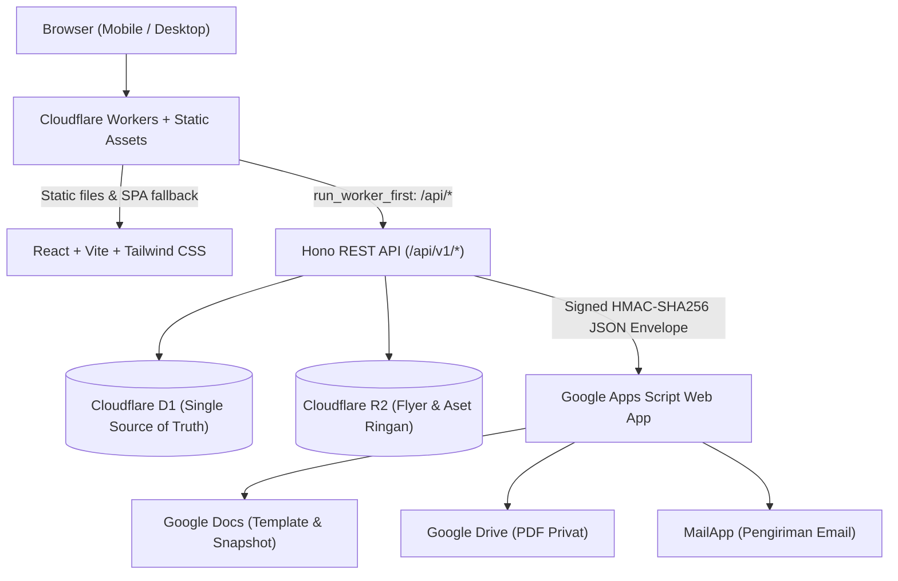

# Arsitektur Sistem — ECER

Dokumen ini menjadi peta repositori dan referensi arsitektur untuk proyek ECER (_Sertifikat dan Piagam Digital — Puskesmas Sumbermanjing Kulon_).

## 1. Gambaran Umum Sistem

ECER menggunakan arsitektur **single-origin full-stack** di atas **Cloudflare Workers + Static Assets**:



### Prinsip Inti

1. **Single-origin**: Frontend dan API berada pada origin yang sama sehingga cookie session `HttpOnly`, proteksi CSRF, dan CSP jauh lebih aman dan sederhana.
2. **Pemisahan tanggung jawab**:
   - **Cloudflare D1**: Single source of truth untuk data kegiatan, formulir, peserta terenkripsi, dokumen, penomoran atomik, durable jobs, sesi admin, dan audit log.
   - **Cloudflare R2**: Khusus flyer kegiatan (WebP/JPEG/PNG) dan aset statis ringan. Tidak digunakan untuk menyimpan backup PII atau PDF sertifikat.
   - **Google Apps Script + Drive**: Khusus ekstraksi placeholder Google Docs, snapshot template, generasi PDF + penyisipan QR, penyimpanan PDF privat, pengambilan PDF terotorisasi, dan pengiriman email via `MailApp`.
3. **SPA fallback tidak mengintersepsi API**: Konfigurasi `wrangler.jsonc` menggunakan `not_found_handling: "single-page-application"` dipadukan dengan `run_worker_first: ["/api/*"]`.

## 2. Peta Repositori (Phase 0 Baseline)

Folder fitur bisnis (`src/features/*`, `worker/modules/*`, `migrations/`, `apps-script/`) sengaja **belum dibuat** pada Phase 0 agar tidak ada folder kosong tanpa tujuan, dan akan ditambahkan secara bertahap mulai Phase 1–2.

```text
ecer/
├── AGENTS.md                     # Aturan kerja AI agent (ringkas)
├── PRD.md                        # Single source of truth kebutuhan produk
├── PRODUCT.md                    # Konteks & prinsip produk
├── DESIGN.md                     # Fondasi design system
├── README.md                     # Panduan singkat proyek
├── package.json                  # Scripts dan dependencies
├── tsconfig.json                 # TypeScript root references
├── tsconfig.app.json             # TypeScript config frontend (src + shared)
├── tsconfig.worker.json          # TypeScript config Worker (worker + shared)
├── tsconfig.node.json            # TypeScript config tooling (Vite, Vitest)
├── vite.config.ts                # Vite + React + Tailwind v4 + Cloudflare plugin
├── vitest.config.ts              # Konfigurasi Vitest
├── wrangler.jsonc                # Konfigurasi Cloudflare Workers + Static Assets
├── eslint.config.js              # ESLint flat config
├── .prettierrc                   # Konfigurasi Prettier
├── .env.example                  # Contoh env non-secret (Vite/client)
├── .dev.vars.example             # Contoh env/secret lokal untuk Wrangler
├── index.html                    # Entry HTML SPA
├── docs/
│   ├── ARCHITECTURE.md           # Dokumen ini
│   ├── DATABASE.md               # Rancangan skema D1
│   ├── API.md                    # Kontrak REST API /api/v1
│   ├── SECURITY.md               # Arsitektur keamanan & privasi
│   ├── ROADMAP.md                # Progres Phase 0–12
│   ├── CHANGELOG.md              # Catatan perubahan
│   └── decisions/
│       └── 0001-phase0-architecture-baseline.md
├── shared/
│   ├── constants/                # Konstanta lintas frontend-backend (API, error codes)
│   └── schemas/                  # Zod schemas & DTO contracts bersama
├── src/
│   ├── main.tsx                  # Entry point React
│   ├── app/
│   │   └── App.tsx               # Shell aplikasi & health check frontend Phase 0
│   ├── lib/
│   │   └── api-client.ts         # HTTP client tipis untuk /api/v1
│   └── styles/
│       ├── tokens.css            # Semantic CSS variables dari DESIGN.md
│       └── index.css             # Entry Tailwind CSS v4 + base accessibility rules
├── worker/
│   ├── index.ts                  # Entry point Cloudflare Worker (fetch handler)
│   ├── app.ts                    # Inisialisasi Hono app, middleware, dan routing /api/v1
│   ├── env.ts                    # Definisi tipe Worker bindings & env vars
│   └── middleware/
│       ├── error-handler.ts      # Global error handler & standard error envelope
│       ├── request-id.ts         # Generasi & propagasi X-Request-Id
│       └── security-headers.ts   # Security headers baseline (CSP, nosniff, dll.)
└── tests/
    └── unit/                     # Unit tests shared schemas & Worker health endpoint
```

## 3. Verifikasi Kompatibilitas Platform & Batasan Free Tier

| Komponen                                | Batas Free Tier Terverifikasi                                                                                                                | Kecocokan dengan ECER                                                                                                                                                                    |
| --------------------------------------- | -------------------------------------------------------------------------------------------------------------------------------------------- | ---------------------------------------------------------------------------------------------------------------------------------------------------------------------------------------- |
| **Cloudflare Workers Free**             | 100.000 req/hari, **10 ms CPU/invocation**, 128 MB RAM, 50 subrequest/invocation, hingga 3 Cron Triggers/akun                                | Cocok untuk trafik Puskesmas (~100 peserta/kegiatan). **Risiko utama ada pada batas 10 ms CPU** untuk password KDF dan decoding base64 PDF.                                              |
| **Cloudflare D1 Free**                  | 5 juta rows read/hari, 100.000 rows written/hari, 5 GB storage, 10 DB/akun, 50 query/invocation                                              | Sangat memadai untuk skala single Puskesmas dengan query terindeks dan penomoran atomik `INSERT ... ON CONFLICT ... RETURNING`.                                                          |
| **Cloudflare R2 Free**                  | 10 GB-bulan, 1 juta Class A/bulan, 10 juta Class B/bulan, egress gratis                                                                      | Sangat memadai untuk flyer WebP (150–500 KiB). Catatan operasional: aktivasi R2 di dashboard Cloudflare memerlukan metode pembayaran terdaftar meski pemakaian tetap dalam kuota gratis. |
| **Google Apps Script (Gmail Personal)** | 6 menit/eksekusi, 90 menit/hari trigger runtime, 30 eksekusi simultan/user, `LockService` max wait 30 detik, **`MailApp` 100 penerima/hari** | Cocok untuk generasi dokumen batch kecil. **Kuota email 100 penerima/hari sangat ketat** untuk kegiatan 100 peserta jika ditambah OTP/resend.                                            |

## 4. Register Risiko Teknis & Mitigasi (Phase 1 Technical Gate)

1. **R-01 [Tinggi] — Password KDF vs Batas 10 ms CPU Workers Free**
   - Web Crypto `PBKDF2-HMAC-SHA256` di Workers memiliki batas maksimum 100.000 iterasi dan berpotensi mendekati/melewati 10 ms CPU di Free Tier; Argon2id WASM juga berisiko melebihi 10 ms.
   - _Mitigasi_: Benchmark KDF di staging pada Phase 1. Sesuai PRD §26.2, dilarang melemahkan KDF demi Free Tier; jika tidak konsisten di Free Tier, jadikan deployment blocker untuk keputusan pemilik proyek (upgrade Workers Paid atau alternatif auth).
2. **R-02 [Tinggi] — Kuota Email `MailApp` Gmail Personal (100/hari)**
   - Satu kegiatan berkapasitas 100 peserta langsung menghabiskan kuota harian jika email otomatis aktif.
   - _Mitigasi_: Recovery code adalah jalur utama pencarian (tanpa email), OTP bersifat cadangan ber-rate-limit, `MailApp.getRemainingDailyQuota()` dicek sebelum kirim, dan email yang melewati kuota masuk status `deferred_quota` tanpa menggagalkan PDF.
3. **R-03 [Tinggi] — Transfer PDF Base64 & Generasi QR di Workers Free**
   - Decoding base64 JSON PDF hingga 2 MiB dan pembuatan gambar QR bisa memicu spike CPU > 10 ms.
   - _Mitigasi_: Uji beban PDF (hingga 2 MiB) dan benchmark QR generator ringan di Phase 1. Siapkan opsi Google Drive API authenticated streaming jika base64 melewati batas CPU/memori.
4. **R-04 [Sedang] — Redirect `302` Google Apps Script `ContentService`**
   - Web App `doPost` Google mengembalikan redirect `302` ke `script.googleusercontent.com` dan tidak selalu mendukung custom HTTP status code.
   - _Mitigasi_: Validasi allowlist host redirect (`script.google.com`, `script.googleusercontent.com`), jangan teruskan signed body ke host lain, dan selalu validasi JSON envelope hasil.
5. **R-05 [Sedang] — Rate Limiting pada WiFi Puskesmas (Shared Public IP)**
   - Peserta yang mengisi formulir bersama di lokasi kegiatan berbagi 1 IP publik.
   - _Mitigasi_: Jangan gunakan IP sebagai satu-satunya kunci rate limit; kombinasikan IP, event ID, lookup key hash, session/grant, dan Turnstile.
6. **R-06 [Rendah] — Cron Trigger Micro-Batching**
   - Tiap eksekusi Cron di Free Tier juga terikat 10 ms CPU (meski waktu tunggu I/O jaringan tidak dihitung sebagai CPU).
   - _Mitigasi_: Proses batch sangat kecil (1–3 job per tick) dengan conditional claim dan `lease_expires_at`.
