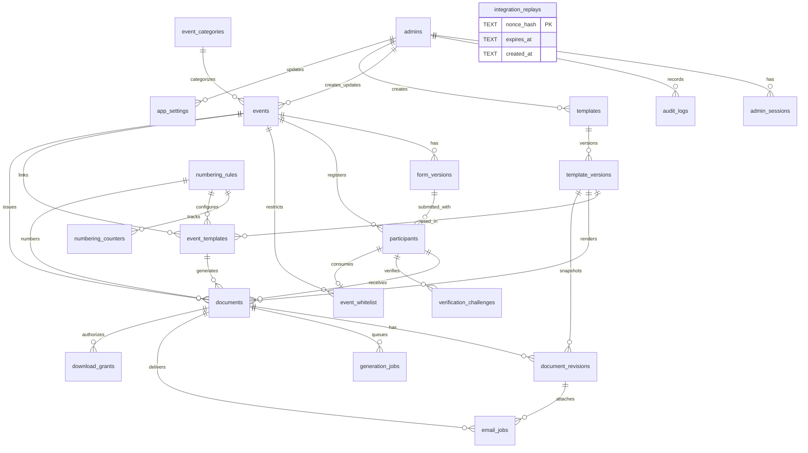

# Rancangan Database — ECER (Cloudflare D1)

Dokumen ini mendokumentasikan skema database Cloudflare D1 (SQLite) aktual berdasarkan `PRD.md` §23 dan berkas migration di `migrations/`.

## 1. Berkas Migration Aktif

1. `migrations/0001_phase1_security_foundation.sql` — `admins`, `admin_sessions`, `integration_replays`, `audit_logs`
2. `migrations/0002_core_business_schema.sql` — 17 tabel bisnis inti + seed 9 `event_categories` awal + default non-secret `app_settings` + seluruh indeks wajib

## 2. Konvensi Database

- **Primary Key**: UUID v4 (`TEXT PRIMARY KEY`).
- **Penamaan**: `snake_case` untuk seluruh tabel dan kolom.
- **Timestamp**: Disimpan dalam format ISO-8601 **UTC** (`TEXT`); konversi `Asia/Jakarta` dilakukan di lapisan presentasi/input.
- **Integritas**: Aktifkan `PRAGMA foreign_keys = ON`, gunakan `CHECK` constraints untuk enum status, serta `UNIQUE` constraints untuk aturan bisnis.
- **Query safety**: Selalu gunakan parameterized SQL; hindari `SELECT *` pada endpoint produksi.
- **Larangan penyimpanan**: Dilarang menyimpan binary PDF atau base64 PDF permanen di D1. Dilarang menyimpan secret di `app_settings`.

## 3. Strategi Keamanan Data di D1

- **Enkripsi kolom sensitif**: `participants.encrypted_data`, `participants.email_encrypted`, `event_whitelist.encrypted_data`, `documents.recipient_data_encrypted`, `document_revisions.data_snapshot_encrypted`, dan `email_jobs.recipient_email_encrypted` menggunakan **AES-GCM** dengan random IV unik dan metadata versi kunci (`DATA_ENCRYPTION_KEY`).
- **Pencarian exact match**: `unique_key_hash`, `search_key_hash`, dan `whitelist_key_hash` menggunakan **keyed HMAC-SHA256** (`LOOKUP_HMAC_KEY`).
- **Unique constraints kritis**:
  - `participants(event_id, unique_key_hash)` — mencegah duplikasi peserta secara atomik.
  - `numbering_counters(rule_id, scope_key)` — mencegah tabrakan urutan nomor dokumen.
  - `documents(document_number)`, `documents(verification_code)`, `documents(issuance_key)` — menjamin keunikan nomor, kode verifikasi, dan idempotensi penerbitan.
  - `generation_jobs(idempotency_key)`, `email_jobs(idempotency_key)` — menjamin idempotensi antrean.

## 4. Entity-Relationship Diagram (ERD Aktual)

